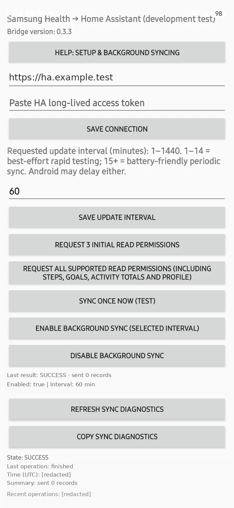

# Samsung Health Bridge

**ANDROID ONLY | PROVEN AS WORKING BUT ONLY FOR SOFTWARE DEVELOPMENT AND TESTING ONLY**

Samsung Health Bridge is an independent development project that reads permitted Samsung Health records on an Android phone and sends them over authenticated HTTPS to Home Assistant (HA). It complements the existing Home Assistant Companion App and Google Health Connect rather than replacing them. HA Is normally unable to show all health related records from the Galaxy Watch for a variety of complex reasons as discussed below and this integration resolves 99% of that issue by acting as a bridge between the Android Samsung Health app and HA.

**Developer requirements:** A compatible Android phone with Samsung Health, Samsung Health Data SDK developer access, an authorized local SDK copy, the separate Android development app, and a Home Assistant server. **No extra watch application is needed.** This is not a general consumer application or a medical monitoring system. All required instructions for a developer for each of these pieces is included. Samsung Health Data SDK is proprietary and is **not included** in the repository. See [SDK requirements](docs/SDK_REQUIREMENTS.md).

## What is Health Connect?

Google Health Connect is Android's on-phone health-data sharing system. It allows supported fitness and health apps to exchange compatible records with permission. In this setup it lives **on the Android phone**, not on the watch or Home Assistant server. The Home Assistant Companion App can read supported Health Connect data, but Samsung Health does not export every Samsung record or proprietary score to Health Connect, and the two systems use different data schemas.

Samsung Health Bridge reads the permitted Samsung Health records **directly through Samsung Health Data SDK on the phone** and sends missing information to Home Assistant. It does not write data into Health Connect. A more detailed comparison follows below.

## What does it add?

Watch-origin blood pressure and pulse, Samsung Energy Score and Sleep Score, skin-temperature records, expanded body-composition values, activity and nutrition goals, and original measurement histories are among the data paths enabled by the bridge. Not every record type is available on every device, and not every SDK record has a dedicated sensor. The [comparison tables below](#what-this-bridge-adds-to-home-assistant-the-detailed-comparison) show the differences from the regular Health Connect route.

**Development reference:** On Home Assistant Core 2026.11.2, the bridge was configured through the UI with 103 registered entities. The Android development app v0.3.3 successfully uploaded a new blood-pressure record, and existing SQLite-backed charts remained accessible.

## Developer setup: watch, phone, and Home Assistant

| Component | What developers install or configure |
| --- | --- |
| Galaxy Watch | Existing Samsung Health app and, where supported, Samsung Health Monitor App. No separate bridge watch APK or watch developer mode. [Watch setup](docs/WATCH_DEVELOPER_SETUP.md) |
| Android phone | Samsung Health app, Samsung Health Monitor App when applicable, and developer-built SamsungHealthReporter bridge app. [Android installation and all controls](docs/ANDROID_DEVELOPER_INSTALL.md) |
| Home Assistant | `custom_components/samsung_health_bridge/`, then **Settings → Devices & services → Add integration → Samsung Health Bridge**. [Home Assistant setup](docs/HOME_ASSISTANT_INSTALL.md) |
| Developer computer | Android Studio with compatible toolchain and Samsung's locally obtained SDK AAR. [Android source project](https://github.com/KruseLuds/samsung-health-ha-bridge/tree/main/android/SamsungHealthReporter) |

The Home Assistant Marketplace/HACS integration installs only the Home Assistant component. **It does not install the Android phone app.** The watch continues to work through Samsung's own software.

### Step 1. Prepare the watch and Samsung Health

Pair the Galaxy Watch with the Android phone. Verify that the watch's measurements appear in Samsung Health on the phone. For supported watch blood-pressure measurements, use the existing Samsung Health Monitor applications on watch and phone. See the [watch developer guide](docs/WATCH_DEVELOPER_SETUP.md).

### Step 2. Install the Home Assistant receiver

Install the repository's `custom_components/samsung_health_bridge/` integration in Home Assistant and add **Samsung Health Bridge** through the Devices & services UI. Confirm its entities appear, including `sensor.samsung_bridge_last_received`. Use the [Home Assistant installation guide](docs/HOME_ASSISTANT_INSTALL.md).

### Step 3. Build and install the phone development app

Open the [Android Studio source project](https://github.com/KruseLuds/samsung-health-ha-bridge/tree/main/android/SamsungHealthReporter), obtain the genuine Samsung Health Data SDK from Samsung and place its AAR in the local `library/libs/` folder. Follow the [Android developer installation guide](docs/ANDROID_DEVELOPER_INSTALL.md) for compilation, deployment, Android Developer Options and Samsung Health SDK developer access. Do not add the proprietary AAR to Git.

### Step 4. Configure every control on the Android development screen (v0.3.3)

The below is an actual screen shot on an android phone of the SamsungHealthReporter app (with some details anonymized). The ha.example.test https url shown is to be replaced with the external URL of your HA instance, and the token is already there but hidden once saved. Sometimes there are no records to retrieve but success or failure in the retrieval is always shown, with full details of the type and number of records shown of each type visible when you scroll further down on that screen.



*Actual v0.3.3 development screenshot. Private address and timestamps have been replaced; no access token is shown.*

| Screen control | Developer action and purpose |
| --- | --- |
| **HELP: SETUP & BACKGROUND SYNCING** | Opens built-in help for permissions, scheduling, phone battery settings and diagnostics. |
| **Home Assistant URL** | Enter the reachable HTTPS base URL for the development server, not the `/api/...` endpoint. |
| **Paste HA long-lived access token** | Paste a Home Assistant long-lived access token from a dedicated development account. Never put it in screenshots or Git. |
| **SAVE CONNECTION** | Stores URL and token. It does not upload records by itself. |
| **Requested update interval (minutes)** | 1 to 1440 minutes. 1 to 14 is rapid best-effort testing; 15 or more requests periodic work. **60** is a practical development setting. |
| **SAVE UPDATE INTERVAL** | Saves interval and updates any active background schedule. |
| **REQUEST 3 INITIAL READ PERMISSIONS** | Requests read access to blood pressure, Energy Score and sleep only. |
| **REQUEST ALL SUPPORTED READ PERMISSIONS** | Requests expanded SDK reads including steps, goals, activity, nutrition and supported profile access. Confirm actual grants on the phone. |
| **SYNC ONCE NOW (TEST)** | Queues a one-time SDK read and authenticated upload. `SUCCESS ... sent 0 records` can be normal. |
| **ENABLE BACKGROUND SYNC (SELECTED INTERVAL)** | Enables scheduled work at the saved interval. Android may delay it. |
| **DISABLE BACKGROUND SYNC** | Stops scheduled work without deleting stored health records or saved permissions. |
| **Last result / Enabled / Interval** | Check the most recent job outcome, record count and whether recurring work is enabled. |
| **REFRESH SYNC DIAGNOSTICS** | Reloads job diagnostics without starting another sync. |
| **COPY SYNC DIAGNOSTICS** | Copies operational diagnostics for debugging; inspect and redact before sharing. |
| **State / Last operation / Time (UTC) / Summary / Recent operations** | Review job status, stage, UTC timestamp, outcome and recent operations to locate failures. |

### Step 5. Configure phone background operation

On a Samsung Galaxy development phone, enable these settings **for SamsungHealthReporter or Samsung Health Bridge**, depending on the installed app label. Samsung menus can vary by One UI release:

1. **Settings → Battery → Background usage limits → Never auto sleeping apps / Never sleeping apps**: add the bridge app. Confirm it is absent from **Sleeping apps** and **Deep sleeping apps**.
2. **Settings → Apps → SamsungHealthReporter → Battery**: select **Unrestricted**, or the equivalent setting permitting background battery use, if offered.
3. **Settings → Apps → SamsungHealthReporter → Mobile data**: allow background data; if Data Saver is enabled, permit the bridge to use data when Data Saver is on if that choice exists.
4. Do not **Force stop** the development app or clear its storage. After reinstalling or rebooting, reopen the app and verify **Enabled: true**, permissions and the most recent operation.
5. Keep Samsung Health on the phone able to synchronize watch measurements. The bridge cannot upload a watch record until Samsung Health has received it.
6. In the app, save the **60-minute interval**, perform **SYNC ONCE NOW (TEST)**, verify `sensor.samsung_bridge_last_received` in Home Assistant, then enable background sync.

These settings improve background reliability but **do not guarantee an exact hourly run**. Android WorkManager may still defer jobs during Doze, low-battery conditions, or network restrictions. See [Samsung sleeping-app settings](https://www.samsung.com/us/support/answer/ANS10003442/) and [Android WorkManager](https://developer.android.com/reference/androidx/work/PeriodicWorkRequest).

### Step 6. Verify the development data path

Check the latest app result and diagnostics, the Home Assistant `sensor.samsung_bridge_last_received` timestamp, relevant `sensor.samsung_bridge_*` entities, and the historical dashboard. A successful zero-record incremental run does not mean data was lost. Review [complete Android troubleshooting](docs/ANDROID_DEVELOPER_INSTALL.md) for SDK or HTTP failures.

---

## What is Google Health Connect?

**Google Health Connect is Android's on-device health-data sharing system.** It is completely independent of Samsung. Its purpose is to let different health and fitness apps exchange compatible health information through a common set of standard record types, with the developer's permission. It does **not** measure health data itself. It does not automatically contain everything stored by Samsung Health, and it is not a cloud service.

**Where it lives:** Health Connect resides **on the Android phone only** in this setup, not on the Galaxy Watch or the Home Assistant server. On Android 14 and later, it is an Android system component managed from the phone's Settings. On supported older Android versions, it may be a separately installed Google app. Samsung Health can write selected (only selected) records into it. The **Android Home Assistant Companion App**, when granted Health Connect permissions and configured to expose relevant sensors, can read its supported records and send them to Home Assistant.

Normal path:

```text
Galaxy Watch sensors / Samsung apps
          |
          v
 Samsung Health on Android phone
          |
          | Samsung shares SELECTED compatible records
          v
 Google Health Connect on SAME phone
          |
          | Android HA Companion reads supported, permitted types
          v
 Home Assistant Companion App on phone
          |
          v
      Home Assistant
```

There are **two distinct limitations**. First, Samsung does not export all available Samsung Health records into Health Connect. Second, even if Health Connect has a standardized record, the **Home Assistant Companion App only exposes the fields and sensors its current implementation supports**. Thus: *shown in Samsung Health* does not mean *present in Health Connect*, and *present in Health Connect* does not mean *exposed as a Home Assistant entity*.

**Samsung Health and Health Connect also use different schemas.** Samsung's record types and metadata do not match Google's one-for-one. The same physiological measurement may have different field names, units, time handling, source IDs, session structures, and optional details. Some Samsung-only calculated scores or goals have no equivalent Health Connect record. A supported Health Connect `BloodPressureRecord` does **not** mean Samsung exports all Samsung Health Monitor watch BP readings into it. A converter would need mapping, and sometimes would discard Samsung-specific metadata. This bridge avoids depending on that conversion for missing Samsung records.

## What this bridge adds to Home Assistant: the detailed comparison

**These tables are the main reason the project exists.** The comparison is against the **standard Android Home Assistant Companion App's Health Connect sensors**, not against every possible custom HA integration. The right-hand column describes what is actually implemented by the uploaded bridge source. A named latest-value entity appears only when the receiver has a usable matching record or aggregate; records and metadata may be retained even without a named value sensor.

**Reading the tables:** **Latest** means a named HA sensor for the most recent recorded value. **History** means a bridge sensor with an attribute containing timestamp/value pairs, not an unlimited Recorder time series. **Stored** means the receiver keeps the source record in SQLite but may expose only a record count until a future dashboard projection is added. An asterisk (`*`) identifies an **expanded-mode capability requiring further live-device and end-to-end confirmation**. See the single note below the tables.

### A. The most compelling gaps: missing Samsung values and richer Samsung-specific measurements

| Samsung measurement or record | Google Health Connect (incomplete) -> HA today | What this bridge adds to HA |
| --- | --- | --- |
| **Watch-origin blood pressure: systolic** | HA supports systolic BP **if** a BP record reaches Health Connect. In project testing, Samsung Health Monitor **watch-origin BP did not**; manual Samsung Health BP could. | **Latest watch systolic** in mmHg, plus original-measurement **history**, filtered by Health Monitor source. |
| **Watch-origin blood pressure: diastolic** | Same source-export gap as systolic BP. | **Latest watch diastolic** in mmHg and separate timestamped **history**. |
| **Pulse recorded with a watch BP reading** | Companion's generic heart-rate reading is not necessarily the pulse belonging to a particular BP measurement. | **BP-associated pulse**, preserving its association with the originating watch BP record, plus history. |
| **Samsung Energy Score** | No dedicated Android Companion Health Connect entity for Samsung's proprietary Energy Score. | **Samsung's calculated 0-100 Energy Score**, latest value and dated history, rather than an approximation computed by HA. |
| **Samsung Sleep Score** | Companion supports sleep times and stages, but not Samsung's proprietary Sleep Score as a distinct sensor. | **Actual Samsung Sleep Score (0-100)**, latest and historical scores from the original Samsung sleep records. |
| **Skin temperature** | Companion lists body/basal body temperature, **not a dedicated skin-temperature entity**. These are not interchangeable measurements. | **Samsung skin temperature** in °C, latest and historical records; available minimum and maximum within a record. * |
| **Body fat mass** | Companion exposes body fat percentage and weight, but not a dedicated Samsung fat-mass sensor. | **Fat mass in kilograms** when present in Samsung's body-composition record. * |
| **Muscle mass percentage** | No dedicated Samsung muscle-percentage Health Connect entity in the documented Companion list. | **Muscle mass percentage**. * |
| **Skeletal muscle percentage** | No dedicated Samsung skeletal-muscle-percentage entity. | **Skeletal muscle percentage**. * |
| **Skeletal muscle mass** | No dedicated Samsung skeletal-muscle-mass entity. | **Skeletal muscle mass in kilograms**. * |
| **Food calories and macronutrients** | The documented Android Companion Health Connect list does not include food calories, carbohydrates, protein or dietary-fat sensors. | Latest **food-record calories, carbohydrates, protein, total fat**, and the original nutrition records. * |
| **Additional nutrition detail** | No dedicated Companion entities for these Samsung food fields. | Latest **fiber, sugar and sodium**. The stored raw Samsung payload can contain **additional nutrient fields** beyond the current latest-value projections. * |
| **Samsung personal goals** | Companion reports several measured totals but does not have equivalent dedicated Samsung-specific goal entities. | **Daily steps goal, active-calorie goal, active-time goal, nutrition-calorie goal, water-intake goal, target bedtime and target wake time** via Samsung's daily aggregates. * |

This is not a claim that Google Health Connect has *no* relevant data types for nutrition or goals. It is a comparison against what the **Android Home Assistant Companion App currently publishes as Health Connect entities**, plus the gaps observed in Samsung's exports, when  using a Galaxy S26 Ultra and the Galaxy Watch Ultra2.

### B. Additional Samsung data, independent records, and fuller history

These also matter. They let a developer compare data sources, inspect individual measurements, retain the original Samsung source timestamp, and build Samsung-specific dashboards even where HA already has a roughly comparable Health Connect sensor.

| Samsung measurement or record | HA through Health Connect today | What this bridge adds to HA |
| --- | --- | --- |
| **Heart rate** | Companion exposes a latest heart-rate value; this is not a complete source-by-source Samsung record archive. | Latest Samsung heart-rate value, **separate timestamped heart-rate history**, and Samsung **daily minimum/maximum**. * |
| **Blood oxygen (SpO₂)** | Companion exposes oxygen saturation. | Samsung **oxygen saturation plus record minimum/maximum** where supplied; source-timestamped **SpO₂ history**. * |
| **Body weight** | Companion already supports weight. | Independent Samsung latest weight, original record and **Samsung-specific weight history**. * |
| **Body fat percentage** | Companion already supports body fat percentage. | Independent Samsung percentage and **Samsung body-fat history**. * |
| **Height and BMI** | Companion supports height. BMI is not a dedicated Health Connect Companion sensor in the documented list. | Latest **Samsung height** and **Samsung-calculated BMI** from body-composition records. * |
| **Total body water and basal metabolic rate** | Companion already supports body-water mass and BMR when those values reach Health Connect. | Independent Samsung **total body water in liters** and **BMR in kcal/day**. These are additional source values, **not inherently missing data types**. * |
| **Sleep-session duration** | Companion supports duration and sleep-stage detail when synchronized and enabled. | Samsung sleep-session duration in minutes, dated history, and source records. **Sleep duration alone is not new to HA**. |
| **Sleep sessions and stages** | Companion supports sleep-stage durations and stage timeline attributes in current documentation. | Original Samsung session records, including available stage details, retained in SQLite. **No complete separate stage-by-stage bridge sensor suite yet.** * |
| **Daily steps and distance** | Companion already exposes steps and distance. | Samsung's own daily **step and distance aggregates**, plus timestamped **steps/distance series** for dashboards. * |
| **Active calories** | Companion supports active calories. | Samsung daily active-calorie aggregate and a separate dated **history**. * |
| **Total calories burned and active time** | Companion supports total calories, but not a Samsung-defined active-time summary entity. | Samsung daily **total calories burned** and **active time** aggregates. * |
| **Floors climbed** | Companion already supports daily floors. | Samsung daily floors aggregate and stored original floor-climb records. * |
| **Exercise duration and exercise calories** | Companion Health Connect list does not provide these as dedicated Samsung exercise-summary entities. | Samsung's daily **exercise duration** and **exercise calories** aggregates; exercise records are also stored. * |
| **Water consumed** | Companion already provides daily hydration. | Independent Samsung daily **water-intake total**, plus stored original water records and Samsung water goal. * |
| **Nutrition calorie total** | Not an Android Companion Health Connect nutrition sensor in its documented list. | Samsung **daily food-calorie total**, which is different from calories **burned**, plus the latest stored food record fields. * |

**`*` Expanded mode:** These collectors or value mappings are present in the uploaded source, but the exact records and sensors a person receives depend on their device, Samsung Health data, per-type SDK permissions, and further live end-to-end testing. A grant is not proof of populated records. The receiver does not invent zeroes for missing values. Some daily aggregate units are raw SDK units and require dashboard formatting, for example milliseconds for duration and seconds since midnight for sleep-time goals.

### C. Important additional record types not yet offered as full dashboard measurements

The Android expanded reader and HA receiver support source records for these categories, but the supplied receiver **does not yet create a dedicated latest-value measurement entity for each of them**. It stores accepted records and shows a **record-count sensor** per type. This still lays the groundwork for richer dashboards, but we will not market record counts as finished measurement displays.

| Samsung source category | HA through Health Connect today | Current bridge result |
| --- | --- | --- |
| **Blood glucose** | Companion supports a latest blood-glucose sensor when Health Connect contains data. | Samsung source records retained; count sensor only. * |
| **Body temperature** | Companion supports body temperature. | Samsung source records retained; count sensor only. * |
| **Exercise sessions** | No equivalent complete Samsung session-detail entity in Companion's basic HC sensor list. | Original exercise records retained; count sensor plus daily exercise aggregates. * |
| **Floors climbed records** | Companion provides the daily floors total. | Individual Samsung source records retained; count sensor plus daily aggregate. * |
| **Water-intake records** | Companion provides daily hydration. | Individual Samsung source records retained; count sensor plus daily aggregate. * |
| **Irregular heart-rhythm notifications** | No Companion Health Connect sensor exposing Samsung's specific record. | SDK-readable records may be stored with counts, **not a real-time arrhythmia alarm or clinical notification**. * |
| **Sleep-apnea records** | No dedicated Companion sensor exposing Samsung's specific record. | SDK-readable records may be stored with counts, **not a diagnosis, apnea chart or alert feature**. * |
| **Samsung profile record** | Not a comparable HA Companion health-history entity. | Optional SDK profile JSON may be retained and counted. **Sensitive profile information is not published as a dedicated HA profile dashboard.** * |

**Not supported:** Samsung's separately named **overnight Blood Pressure Trend** dataset is **not exposed by the investigated SDK** according to Samsung Developer Support, despite ordinary watch BP readings being SDK-readable. This project also does **not** deliver ECG waveforms or reports. Neither should be listed as a working feature.

### What has actually been observed, versus what the code is prepared to handle

- **Observed in development testing:** SamsungHealthReporter returned **41 ordinary BP records, including 31 originating from Samsung Health Monitor and 10 manual records**. The phone bridge deliberately filters uploads to **Health Monitor watch-origin BP** to avoid duplicating manual BP already accessible through Health Connect. These are source-record observations, not a claim that the separate overnight Trend feature is accessible.
- **Verified by source inspection:** The project includes Samsung Health Data SDK record readers, the three core measurements, **expanded read permission logic**, **20 daily aggregate operations**, named latest-value mappings, recent-history sensors, an HTTPS POST sender, and a Home Assistant SQLite receiver.
- **Previously confirmed development configuration:** The test phone requested expanded READ access and reported **24/24 grants**. This does **not** certify that every optional data type has nonempty records or its own finished HA graph. A developer's current device configuration still needs to be checked directly.

## How the data actually gets into HA

```text
                           GALAXY WATCH
          hardware sensors + Samsung Health / Health Monitor apps
                                   |
                      watch-to-phone synchronization
                                   v
                      SAMSUNG HEALTH APP ON PHONE
                                   |
                   +---------------+------------------+
                   |                                  |
              EXISTING PATH                      THIS BRIDGE
                   |                                  |
      selected records exported             Samsung Health Data SDK
      into Google Health Connect            (authorized access to
                   |                         Samsung Health records)
                   |                                  |
      HA Companion App on phone             SamsungHealthReporter
                   |                                  |
                   |                          Android bridge worker
                   |                          (scheduled + incremental)
                   |                                  |
                   |                         HTTPS + HA bearer token
                   |                                  |
                   +-----------------+----------------+
                                     v
                             HOME ASSISTANT
                    standard Companion entities +
                 bridge latest values, histories, counts
                           + SQLite source archive
```

The bridge **does not write records into Health Connect**, nor does it require Home Assistant to read Samsung Health's private database. It complements the normal path. **Why a phone app is essential:** the Samsung Health Data SDK runs on an Android phone where Samsung Health is installed; the Home Assistant server cannot execute that SDK against the phone remotely. SamsungHealthReporter performs SDK reads, the Android bridge schedules/uploads authorized data, and the HA receiver stores/publishes it.

### Expanded mode is more than a checkbox

The Android app offers **“Request 3 initial READ permissions”** (core) and **“Request ALL supported READ permissions (including steps, goals, activity totals and profile)”** (expanded). This is an **actual option in `BridgeActivity.kt`**, not merely a roadmap idea.

**Core mode:** ordinary watch-origin blood pressure, Samsung Energy Score, and sleep records. **Expanded mode:** all readable types defined by the included reporter, together with aggregate-only data and the optional profile reader. The expanded set deliberately does **not** request the separate exercise-route-location permission. Individual unsupported, ungranted, empty, or skipped SDK operations must be reported honestly.

**Timing:** The default requested background interval is 60 minutes. Android WorkManager can delay it. Initial record backfill is bounded to 30 days for core types, 2 days for heart rate, and 7 days for most other types. Twenty aggregate operations are queried in daily buckets over the last 7 days and normally throttled to at most one check per 15 minutes; the sender does not continuously stream every watch measurement. Changed records and deletions are handled incrementally after the initial snapshot.

### What's visible on the HA side, exactly?

**Verified November 19, 2026:** Home Assistant Core 2026.11.2 now runs a UI-configured **Samsung Health Bridge** integration with **103 registered sensor entities**. The entity names below match the migrated receiver and preserve existing dashboard references. Individual measurements still require usable Samsung Health records; a registered entity may have no current value until its first applicable record arrives.

| HA entity or pattern | Meaning |
| --- | --- |
| `sensor.samsung_bridge_watch_bp_systolic` / `_diastolic` / `_pulse` | Latest ordinary Health Monitor watch BP and associated pulse |
| `sensor.samsung_bridge_energy_score` | Samsung Energy Score, 0-100 (score, not percent). The migrated integration no longer declares `%` as the unit. A separate dashboard template may still append `%` and requires correction. |
| `sensor.samsung_bridge_sleep_score` / `_sleep_duration` | Most recent Samsung score and sleep duration |
| `sensor.samsung_bridge_skin_temperature` / `_min` / `_max` | Latest Samsung skin temperature fields, if supplied |
| `sensor.samsung_bridge_heart_rate` / `_min` / `_max` | Latest Samsung heart-rate record fields, if supplied |
| `sensor.samsung_bridge_oxygen_saturation` / `_oxygen_min` / `_oxygen_max` | Latest Samsung oxygen fields, if supplied |
| `sensor.samsung_bridge_body_*` | Body-weight, height, fat, fat mass, BMI, muscle, skeletal muscle, water, BMR fields |
| `sensor.samsung_bridge_nutrition_*` | Selected latest nutrition-record fields |
| `sensor.samsung_bridge_aggregate_*_latest` | One value for the latest available bucket of each applicable Samsung daily aggregate |
| `sensor.samsung_bridge_history_*` | History entity: **state is number of points**, timestamp/value pairs in `points` attribute |
| `sensor.samsung_bridge_<type>_record_count` | Number of non-deleted source records retained for that category |
| `sensor.samsung_bridge_last_received` | Time the HA receiver last accepted a sync batch |

**Very important:** The history entities hold **up to 120 points per series from the last 180 days** in attributes. The underlying SQLite database retains more accepted records; the 120-point display limit is not an archive-retention limit. Those 14 series are watch BP systolic/diastolic/pulse; Energy Score; Sleep Score and duration; SpO₂; skin temperature; weight; body fat; heart rate; steps; active calories; and distance.

**Development data availability:** Some categories are *record storage only* and have no dedicated latest-value measurement entity for their individual fields. A successful build or a granted Samsung READ permission does not prove that a category will have data. The 103 registered entities and retained history are confirmed in the reference development installation; a clean third-party installation and each optional data type still require independent testing.

## Why direct Samsung SDK access matters

Google Health Connect standardizes many common record types, but it is not Samsung Health's own schema or a complete mirror of its data. Some readings are never exported, some Samsung scores and goals lack a direct equivalent in Companion sensors, and some richer fields or historical records are lost or unavailable downstream. A developer can inspect a record in Samsung Health and still have no way to use it in Home Assistant through the standard Health Connect route.

The bridge uses Samsung Health Data SDK for **authorized reads from Samsung Health's on-phone store**. It preserves source IDs, original timestamps and application/device provenance where available, uploads changed source records, and keeps them in a local SQLite archive in HA. That architecture unlocks **source-specific history and future dashboard possibilities** without replacing or breaking the Companion App's existing Health Connect entities. It is an engineering approach to fill documented gaps, not a claim of bypassing Samsung's restrictions.

### What isn't magically solved

- Samsung's **overnight Blood Pressure Trend** remains unavailable through the SDK investigated here. An ordinary watch BP sample is a separate record, and a frequent heart-rate sample is not a BP sample.
- The reader must have permission; individual devices may contain no records of a given type, and SDK grants can be withdrawn.
- Data may be delayed by watch-to-phone sync, Samsung Health updates, Android background scheduling and network availability.
- Profile and medically sensitive record types merit special privacy protection; reading them does not turn HA into a medical monitor.
- The repository includes **no proprietary Samsung `.aar`**. A successful **stub-SDK build** is not a working Samsung Health reader.
- The current HA receiver is a **working UI-configured development integration with 103 registered entities**, tested on Home Assistant Core 2026.11.2. The separate development installations and updates should be checked. The developer's custom dashboards are separate and are not automatically installed by Marketplace.

## The components in detail

The following sections explain every app, service, and diagnostic tool, including the separate Samsung apps on the watch and the phone, the two Home Assistant Companion apps, and the SDK components. Readers who only want the overview can stop here.

### On the Galaxy Watch

#### 1. Physical sensors and Samsung Health Sensor Service

Compatible Galaxy Watches contain sensors such as optical photoplethysmography (PPG) for heart rate, electrical contacts for ECG, inertial sensors for movement, and bioelectrical impedance electrodes for body composition. Model, region, calibration, software version, and regulatory approval determine which measurements work. The watch's Samsung Health Sensor Service and Samsung software process raw signals into health metrics. Some raw or processed sensor data can also be accessed by authorized *watch apps* through the separate **Samsung Health Sensor SDK**; this is **not** the phone's **Samsung Health Data SDK** used by this bridge.

**Examples:** heart rate (bpm), oxygen saturation (SpO₂), movement/steps, sleep detection and stages, body composition, ECG (supported models), and blood pressure (supported models/regions). Not all measurements are continuous, equally precise, or exportable.

#### 2. Samsung Health app on the watch

Samsung Health is the watch's everyday fitness and wellness interface. It collects and summarizes supported activity and physiological measurements, displays results, and synchronizes with Samsung Health on the paired phone according to Samsung's timing rules. The watch-to-phone transfer may be delayed for battery conservation, and some measurements synchronize only after reconnecting or opening the phone application. A measurement can exist on the watch before it is visible on the phone.

#### 3. Samsung Health Monitor App on the watch

Samsung Health Monitor is **distinct from Samsung Health**. On eligible Galaxy Watch/phone combinations, it provides regulated or region-dependent features such as ECG and cuff-calibrated watch blood-pressure measurement. Its results and summaries can be displayed in the corresponding phone app. The presence of a reading in Monitor does **not** guarantee the same underlying record is exported to Health Connect or exposed by Samsung's SDKs.

#### 4. Home Assistant Companion App for Wear OS

The Home Assistant Companion app installed **on the watch** is separate from the Companion app installed **on the phone**. It exposes selected watch/device data directly as Home Assistant entities, depending on available APIs, grants, connectivity, and enabled sensors. This is a useful independent path for selected activity and device statistics, but it is **not a general-purpose Samsung Health or Samsung Health Monitor database reader**. In the original development environment, direct watch entities included activity state, calories, distance, floors, steps, and heart rate; direct watch SpO₂ was not available through that route.

#### 5. Galaxy Wearable / watch-management software

The companion watch-management software handles pairing, configuration, updates, watch connectivity, and related services. It is part of the practical watch-to-phone ecosystem but **is not an export API** for arbitrary historical health records. Its exact companion plugins vary by watch and phone.

### On the Android phone

#### 6. Samsung Health app

Samsung Health is Samsung's main wellness and activity application and data store on the phone. It receives compatible data from the Galaxy Watch and other sources, accepts some manually entered measurements, displays summaries and history, and can exchange **selected** health records with Google Health Connect. It can hold both imported device measurements and manually entered data. Even when both look similar in the Samsung Health UI, their origins may affect whether they are subsequently shared.

Watch-to-phone synchronization and Samsung Health-to-Health Connect export are **separate stages**. In its documentation, Samsung also distinguishes exercise-tracker records from general activity-tracker data that does not transfer through the same Health Connect route.

#### 7. Samsung Health Monitor App on the phone

The phone-side Samsung Health Monitor pairs with the watch-side Monitor experience for supported features, displays BP/ECG results and related reports, and may integrate some results with Samsung Health. It does **not** automatically write every Monitor-generated reading into Health Connect. The project's testing found this especially important for watch-origin BP. It is also critical to distinguish an ordinary watch BP measurement from Samsung's **overnight Blood Pressure Trend** feature, which Samsung developer support has identified as unavailable through the supported SDK/API route examined for this project.

#### 8. Home Assistant Companion App on the phone

The **Android Home Assistant Companion App** connects the phone to a Home Assistant server. In addition to ordinary phone sensors, the full Android application can request Health Connect permissions and expose supported Health Connect categories as Home Assistant entities. It does not simply read every screen or every private database belonging to Samsung Health and Monitor.

Importantly, official Home Assistant documentation now includes **Health Connect sleep duration and sleep-stage timeline attributes**, plus various other mapped health measurements. Availability to a particular developer depends on the installed Companion version, the records actually present in Health Connect, permissions, and whether the relevant sensors have been enabled. **Having a supported Companion entity is not proof that Samsung supplied a record for it.**

Do not confuse the separate Companion app's **Wear OS sensors** with the phone app's **Health Connect sensors**. Both can produce entities, but via different sources and permissions.

#### 9. SamsungHealthReporter

**SamsungHealthReporter** is the Samsung Health Data SDK-based **record-reading component/library** included in the Android project. It is an Android/Kotlin component that queries *authorized data types* from Samsung Health's on-phone data store. In project testing, its reader retrieved record values, IDs, timestamps, and source information, including watch-generated ordinary BP readings that did not appear in Health Connect. The development interface also supported record-oriented results suitable for processing as objects/JSON.

**It is not, by itself, equivalent to the complete Samsung Health → Home Assistant application.** The separate bridge layer is responsible for deciding what to collect, when to synchronize, how to transmit it securely, how to handle retries and duplicates, and how the Home Assistant receiver will store and show it. The project uses the reader; it does **not** depend on copying records into Health Connect first.

**Observed in project testing and represented in the supplied source:** SDK v1.1.0; ordinary BP records (including watch-origin), Energy Score, Sleep Score, and other accessible categories were read in developer testing; one test retrieved 41 BP records, 31 watch-origin and 10 manual. These are **test results, not a general compatibility guarantee**. SamsungHealthReporter is not evidence that overnight BP Trend is accessible.

#### 10. Android WorkManager (background scheduling)

Android WorkManager is the recommended Android framework for **deferrable**, persistent background work. In our tested prototype, a periodic job requested roughly **60-minute synchronization**, with network/battery constraints and retry behavior. This is designed to avoid a permanently running, battery-intensive foreground service. Android can delay periodic tasks; a 60-minute requested interval **is not an exact delivery guarantee**. Synchronization also depends on Samsung Health receiving the watch measurement first.

### On the Home Assistant server

#### 11. Home Assistant and its receiver/storage layer

Home Assistant is the self-hosted automation and dashboard server, often running on Linux, a VM, or a dedicated appliance. It can receive health entities through the Android Companion app and **separately** receive records through this project's bridge receiver. It cannot natively open the phone's protected Samsung Health database or ask Health Connect for records from across the network.

The bridge server uses an authenticated ingest endpoint, persistent storage, source record IDs and measurement timestamps, and development-stage states and histories that dashboards can consume. The receiver defines the authenticated endpoint `/api/samsung_health_bridge/sync` and stores records in `/config/samsung_health_bridge/records.sqlite3`. It publishes registered Home Assistant sensor entities and selected history attributes. Custom dashboards are separate from the integration.

## Diagnostic tools: Health Connect Toolbox and Samsung DataViewer

These tools answer **different diagnostic questions**. Neither should be confused with an ordinary consumer app or a way to bypass protected health data access.

| Tool | Installed on | What it examines | What a positive result proves | What a negative result suggests |
| --- | --- | --- | --- | --- |
| **Health Connect Toolbox** (Google) | Android phone, as a developer/test APK | Records exposed in **Health Connect**; can also insert synthetic/test records | A record exists in Health Connect and can be read under granted permissions | Missing or unshared Health Connect record; **does not prove** it is absent from Samsung Health |
| **DataViewer** (Samsung Health Data SDK) | Android phone, as Samsung's developer/test APK | SDK-accessible records in **Samsung Health** under granted permissions | Samsung's SDK exposes that record in the Samsung Health store | The SDK did not expose it under the test's conditions; **does not prove** no Samsung app can display it |

**Example from project testing:** Samsung's DataViewer and SamsungHealthReporter could reveal normal watch-origin BP records while Health Connect Toolbox did not show them. That identifies a break in the **Samsung Health → Health Connect** path, not a failure of the Home Assistant server. The same experiment did **not** prove the SDK could read the separately named overnight BP Trend dataset.

Official documentation: [Google's Health Connect Toolbox](https://developer.android.com/health-and-fitness/health-connect/test/health-connect-toolbox) and [Samsung's DataViewer](https://developer.samsung.com/health/data/guide/data-viewer.html).

## Important distinctions in the detailed source data

A most-recent value is not a complete history, a sleep session's duration is not its Sleep Score, and a BP-associated pulse is not the same as continuous heart rate. The bridge stores **Samsung measurement timestamps**, source IDs and source application/device metadata where available, instead of assuming the time Home Assistant received an upload is the measurement time. The watch-origin BP filter is deliberate; manually entered BP need not be duplicated from the normal Health Connect route.

Samsung's own **overnight Blood Pressure Trend** is a separate dataset. In Support Request #00037318 Samsung said it is not currently available through Health Connect or the Health Data SDK. This does **not** contradict the successfully read ordinary watch-origin BP records. Do not infer overnight Trend support from a chart full of frequent *heart-rate* readings.

## How this project approaches the missing data

### The design in one sentence

**Use an authorized Android application to read selected Samsung Health records directly through the Samsung Health Data SDK, via SamsungHealthReporter, then synchronize the missing useful records to a private Home Assistant receiver, without using Health Connect as an intermediate database.**

### Two routes, working side by side

```text
                GALAXY WATCH / SAMSUNG SOURCES
                             |
                             v
                 SAMSUNG HEALTH ON ANDROID
                             |
                   +---------+----------------------+
                   |                                |
           EXISTING ROUTE                    GAP-FILLING ROUTE
                   |                                |
       Samsung Health exports               Samsung Health Data SDK
       selected data to HC                  (authorized record reads)
                   |                                |
             HEALTH CONNECT                 SAMSUNGHEALTHREPORTER
                   |                                |
          HA COMPANION (phone)              ANDROID BRIDGE APP
                   |                        (scheduled sync, retry)
                   |                                |
                   |                          AUTHENTICATED TRANSFER
                   |                                |
                   +----------------+---------------+
                                    |
                              HOME ASSISTANT
                            entities / history
```

**Do not disable the normal Health Connect route** simply because this bridge is installed. The project is intended to supplement it with data that route cannot deliver; it should not create uncontrolled duplicate entities for records already available.

### Detailed life of a record

1. **Measurement occurs.** A watch or other Samsung-compatible source measures a supported metric. It may first appear in Samsung Health or Samsung Health Monitor.
2. **The phone receives/stores it.** Samsung's synchronization transfers an eligible record to Samsung Health's phone-side store. This can be delayed.
3. **Android authorizes a reader.** The bridge, using SamsungHealthReporter, requests/grants only the necessary Samsung Health Data SDK read permissions. Samsung SDK developer requirements still apply.
4. **SamsungHealthReporter reads records.** The reader queries applicable data types and, where available, retrieves record IDs, source information, values, units, timestamps, and changed-record information. Data types that the SDK does not expose remain inaccessible.
5. **The bridge selects and synchronizes records.** `BridgeSyncWorker.kt` requests approved Samsung READ categories, performs bounded first-time backfills, then uses Samsung change notifications for incremental uploads. `BridgeScheduler.kt` uses WorkManager, with a default requested interval of **60 minutes**; the interval is not an exact timer.
6. **An authenticated HTTPS request sends records to Home Assistant.** The Android worker posts JSON batches to `/api/samsung_health_bridge/sync` with a Home Assistant bearer token. The receiver requires Home Assistant authentication, validates supported record types, and upserts source records by type and Samsung UID.
7. **Home Assistant represents the results.** The receiver creates the documented development-proof latest-value and history entities, plus record-count sensors. Raw source records and revisions are kept in SQLite. More sophisticated dashboards, complete histories, and separate dashboards require additional configuration.
8. **Records remain traceable.** A correct implementation retains measurement time separately from upload/import time, source identifiers where available, and clear distinctions between manually entered, watch-origin, or computed readings.

### What the bridge does **not** do

- It does not read Samsung Health through an unauthorized private API or directly open protected app databases.
- It does not claim that all Samsung Health Monitor data is readable.
- It does **not** currently retrieve Samsung's separate overnight Blood Pressure Trend dataset through the SDK. This limitation does not apply to ordinary watch BP records confirmed readable in testing.
- It does not need to write records to Health Connect first.
- It does not replace Samsung Health, Samsung Health Monitor, the official Home Assistant Companion App, or Health Connect.
- It does not guarantee real-time monitoring, complete medical history, or clinically reliable measurements.
- It does not turn Home Assistant into a medical device.

## Data integrity, privacy, and Android background constraints

**Data correctness:** Preserve original sample times, time zones, units, source/application identifiers, and stable record IDs when possible. Distinguish measurement time, phone read time, transfer time, and server import time. Treat missing as **missing**, not zero. Handle late arrival, updated records, and duplicates explicitly. A sensor's displayed last value is not itself proof of complete historical ingestion.

**Background sync:** Android WorkManager tasks are inexact. Samsung's own watch sync policy is inexact. A nominal hourly poll may run late, and the most recent watch data may still not have reached Samsung Health. Developers must not rely on this project for urgent health alerts.

**Permissions:** Grant only necessary Samsung/Android health data permissions. Document how to revoke them. Explain any battery-exemption instructions and their trade-offs. Separate SDK permissions from Health Connect permissions.

**Data sensitivity:** Health records are sensitive personal information. Local-first/self-hosted design still requires a secure connection to Home Assistant, authenticated endpoints, protected backups, safe logs, and careful retention rules. Do not post real BP records, dates of birth, identifiers, access tokens, signing keys, or unredacted databases in public issues.

## SDK and licensing essentials

- **For development and testing only.** This is an independent project, not endorsed by Samsung.
- Developers obtain Samsung Health Data SDK from Samsung under its developer terms. **Do not add the proprietary `.aar` to Git.**
- [Samsung Developer Support response, November 18, 2026](docs/samsung-support-response.png): the developer’s own source/APK is distinct from Samsung’s proprietary SDK. Do not publicly share the SDK AAR.
- Project-owned code uses the repository's [MIT license](LICENSE). Third-party code keeps its original attribution in [third-party notices](docs/THIRD_PARTY_NOTICES.md).
- Do not commit tokens, personal health data, private databases, or signing credentials. Read [source security checks](docs/REPOSITORY_SAFETY.md).

## Developer reference links

- [Android phone source](https://github.com/KruseLuds/samsung-health-ha-bridge/tree/main/android/SamsungHealthReporter)
- [Android developer installation](docs/ANDROID_DEVELOPER_INSTALL.md)
- [Watch setup](docs/WATCH_DEVELOPER_SETUP.md)
- [Home Assistant installation](docs/HOME_ASSISTANT_INSTALL.md)
- [Samsung Data SDK](https://developer.samsung.com/health/data/overview.html)
- [Google Health Connect](https://developer.android.com/health-and-fitness/health-connect)
- [Home Assistant Companion Android sensors](https://companion.home-assistant.io/docs/core/sensors/)
